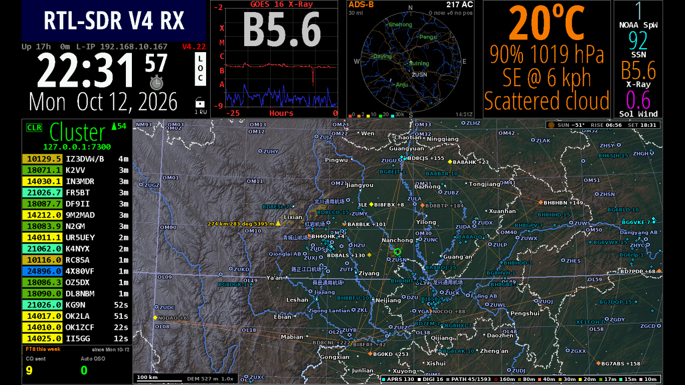

<p align="center"></p>

# 立在 ZUSN 边上放号

<p align="center">
  
</p>

莫斯科号无法同时使用通信和雷达设备，rtl-sdr v4无法同时接收adsb和民用频段。

<p align="center">
  <picture>
    <source media="(prefers-color-scheme: dark)" srcset="fanghao-dark.png">
    
  </picture>
</p>

这是一个业余电台站的软件，跑在一台 Debian 笔记本（ThinkPad X230）上，项目代号 influ。

- **接收**：站里只有一个 RTL-SDR V4，平时守在 1090 MHz，给 FlightAware 和 Flightradar24 喂 ADS-B。调度器在不影响喂数的空当，把它切到 2 米波段听十几秒，收 FT8、看频段活动。
- **发射**：一台 UV-K5，用 CEC 固件经写频线发 FT8。
- **显示**：机器自带屏幕上跑一个本地化的 HamClock。ADS-B 雷达屏是补丁给 HamClock 加的原生窗格，和其他窗格一样在菜单里选，点一下可在 10–100 英里间换量程；覆盖图和本周 FT8 统计由显示程序叠在 HamClock 画面上。在覆盖图上点任意一处，弹出该处的可达性，HamClock 的天气窗格同时换成那里的天气（DX 设在该处），关掉弹窗才换回本站天气。



## 组成

| 目录 | 内容 |
|---|---|
| `sdrmux/` | 独占 SDR 的复用器：1090 MHz 的样本不断流地喂给 dump1090，切走时补零，馈送和 MLAT 不掉线；切出时录下 IQ，事后解 FT8、找 FM 活动 |
| `scheduler/` | 每 15 秒决定 SDR 能不能离开 1090 MHz；FT8 自动通联的状态机、网页审批和可选的 LLM 自由文本回复 |
| `collector/` | 只读记录：Beast 帧、aircraft.json、接收统计、云端参考航迹、天气 |
| `analysis/` | 模型与报告：到达风险模型、训练时段统计、覆盖模型、虚拟切换回测、实际窗口对账、增益 A/B 诊断 |
| `hamclock/` | HamClock 原生全屏窗口：可缩放的 UV-K5 视距覆盖图、业余活动图层、本周 FT8 统计 |
| `tools/` | FT8 网页、UV-K5 读写与刷机、HamClock 补丁、ADS-B 雷达屏、DX 集群过滤 |
| `deploy/` | systemd 用户服务与定时器，以及唯一需要 root 的 `influ-admin` |

说明文档：

- [调度策略](tools/TRAFFIC-POLICY.md)
- [FT8 自动通联](tools/FT8.md)
- [FT8 网页](tools/FT8-WEB.md)
- [LLM 回复](tools/FT8-LLM.md)

## 部署

- 仓库内容放在站上的 `~/influ`，Python 依赖装进 `~/influ/.venv`。
- `deploy/` 里的单元都按用户服务启用。
- `influ-admin` 由站主以 root 安装到 `/usr/local/sbin`，用法见它的文件头。

站点的位置、呼号和网格只放在 `~/influ/station.json`（模板是 `deploy/station.example.json`），不进仓库。发往公共接口（adsb.lol、adsb.fi、Open-Meteo）的位置只取到 0.01°。密钥和登录口令放在 `~/influ/private/`，同样不进仓库。

### 可选的 HamClock 网页

网页地图由 OpenLayers 在浏览器里绘制，直接读取站上的地形瓦片、图层数据和可达性 API。每个页面的地图中心、缩放和地点弹窗独立，本机窗口也不受网页浏览影响；电台与 HamClock 本身的设置仍作用于同一座站。拖拽、缩放和键盘、手柄平移在本地立即响应，地图交互不再等待服务器绘图和传帧。

按需启用，默认不开启：

```sh
mkdir -p ~/.config/systemd/user
cp ~/influ/deploy/hamclock-http.service ~/.config/systemd/user/
systemctl --user daemon-reload
systemctl --user enable --now hamclock-http.service
```

服务监听所有网卡的 IPv4 和 IPv6 地址，内网访问 `http://站机地址:8075/`。滚轮缩放，拖动平移，点击地点查询可达性；触屏支持双指平移和捏合，方向键平移，`+` / `=` / `PgUp` 放大、`-` / `PgDn` 缩小（按一下放大或缩小一档，按住不放也只一档；按住 Shift 时才连续缩放，本机窗口相同），`Esc` 关闭弹窗；打开网页即可用键盘，不必先点地图。点地点时天气窗格同样换成彼处天气，关掉弹窗换回；几个页面和本机窗口都开着弹窗时，以最后打开的为准。手柄（网页用浏览器所在设备的手柄，本机窗口用 pygame.joystick）：左摇杆或十字键平移，右 / 左肩键放大 / 缩小，网页 A 查询地图中心地点，B 关闭弹窗；键盘焦点在地图上时 `Enter` 也查询中心地点。时钟、天气和雷达窗继续使用无损增量帧，地图不传屏幕截图。网页可在本机窗口关闭时独立运行，没有启动加载文字或转圈遮罩。

OpenLayers 10.11.0 的 JS、CSS 和许可证随仓库提供；网页不依赖外部 CDN 或外部地图服务。瓦片来自 `~/influ/model/tiles/`，复用原生窗口的投影与缓存。可达性计算复用 `map_panel.path_profile`，按完整 DEM 分辨率计算判定，图表仅缩减传输采样点。静态图层按视野获取，活动台站与航迹定期更新，图例只数视野内的台站，与本机窗口一致。夜色和晨昏线用本机窗口的同一套算法，按页面当前视野和屏幕像素在站上算出，每分钟更新：夜色垫在河流、路径之下，金线压在它们之上，斜体 SUNSET / SUNRISE 沿线标注，放大多少倍都不糊。

本机窗口与网页均可按 `S` 或 `/` 搜索地图已有的地点、机场和电台呼号：弹出一个 `>_` 输入框，输入名称的一部分即可，不区分英文大小写，汉字与拼音互通：`遂宁` 与 `Suining` 找到的相同，拼音须从音节开头对起（地名的拼音由 pypinyin 按词转写，`重庆` 读作 chongqing；需 `~/influ/.venv/bin/pip install pypinyin`，缺了它只按字面找）；也可像搜索引擎那样写：几个词须同时命中，加引号的 `"学院"` 只按原文找，`-能源` 排除，`city:遂宁`（或 `in:`，写拼音亦可）只取该省、市、区县境内，`type:airport` 只取一类（place、region、campus、military、office、regulator、embassy、airport、station，写开头几个字母即可），如 `city:Suining "学院" -能源`；省、市、区县本身也能搜到，境界取自 `build_tiles.py admin` 生成的 `admin_areas.json`；`↑` / `↓` 或 `Tab` / `Shift+Tab` 选择（鼠标悬停时临时高亮所指一项，按键则从高亮的一项接着走），`Enter` 或点击结果定位并查询可达性，结果右侧是与地图标记同色的经纬度。`Esc` 关闭；长按退格连续删字，删空后停住，空框再按一次退格才关闭。搜索覆盖整张本地地图，不受当前缩放或视野限制，最多取 200 项，一页 8 项，输入行右端是 `9-16/37` 这样的页码；`PgDn` / `PgUp` 或 `Ctrl+F` / `Ctrl+B` 翻页（如 less、vi），在框上滚轮或双指滑动也翻页，`Tab` 和方向键走到页末自动翻过去；只查站内已有数据，不请求外部搜索服务。搜索框不用字体文件，字是一个个点亮的：英文直接读 HamClock 编译所用的 Courier 点阵表（`hamclock/vendor/hamclock-font/`，原样），按它自己画字的办法点在 1600×960 的原生像素上，随时钟画面一起缩放，因此与 DX 集群栏的呼号是同一副字；中文取站机 X11 自带的 1988 年 ISAS 16 点阵宋体（Debian `xfonts-base` 的 `gb16st.pcf.gz`），照 UCDOS 的老办法右移一点再印一遍成粗体。网页只向站上取所用之字的点阵（`/map/dots`，一个汉字 34 字节），在画布上逐点画出。

关闭：`systemctl --user disable --now hamclock-http.service`。也可仅监听本机：`~/influ/.venv/bin/python ~/influ/hamclock/hcweb.py`，默认地址为 `127.0.0.1:8075`。

## 1090 MHz 接收设置

手动增益 49.6 dB，不开 RTL2832 数字 AGC。依据是 `analysis/gain_ab.py report` 对随机分块 A/B 的诊断：

- 数字 AGC 带来的只有噪声：Mode A/C 噪声帧约多 47 倍，落在真实飞机地址上的假帧也更多。
- 真实接收（位置帧、经校验的飞机数）没测出差别。

## 发射

- 只发 FT8。手台必须处在 FT8/Ready，退出即停发。
- 自动发射前必须有一次通过的收发校准（`tools/k5ft8_calibrate.py`）。
- 手台天线要和 SDR 天线隔开，近距离发射会压垮接收机。
- FT8 网页可以加登录（`tools/ft8log_http.py passwd`）；不加的话，局域网里谁都能让手台发射。

## 数据来源与许可

本项目的原创代码采用 [GNU Affero General Public License v3.0](LICENSE)（AGPL-3.0-only）。第三方代码与数据遵循各自的许可证。

- 地图数据 © [OpenStreetMap](https://www.openstreetmap.org/copyright) 贡献者，ODbL，经 Overpass API 获取。
- OSM 里没有的无线电管理机构，地址取自各级政府网站和政务服务网，出处逐条写在 `hamclock/radio_regulators.json`。
- 政府机关：`hamclock/government.json`，取自 OSM 与高德、百度、腾讯地图的 POI 和地理编码，已换算为 WGS-84；监管场所只有 OSM 标注的那些（地图商的检索不返回）。
- 使领馆：四川省、重庆市外事办公室公布的名单，出处逐条写在 `hamclock/embassies.json`。
- 高程：AWS Terrain Tiles（Terrarium 格式），来源见 [Tilezen 的说明](https://github.com/tilezen/joerd/blob/master/docs/attribution.md)。
- [HamClock](https://www.clearskyinstitute.com/ham/HamClock/)（Clear Sky Institute，WB0OEW）。其天气（OpenWeatherMap）、DX 远征和比赛日历数据经 HamClock 的服务获取；本站补丁去掉了屏幕上的来源字样，数据与致谢归原提供者。
- 业余活动：[PSK Reporter](https://pskreporter.info/)、APRS-IS、[WSPR.live](https://wspr.live/)。
- 参考航迹：[adsb.lol](https://www.adsb.lol/)（ODbL）、[adsb.fi](https://adsb.fi/)。
- 天气：[Open-Meteo](https://open-meteo.com/)（CC BY 4.0）。
